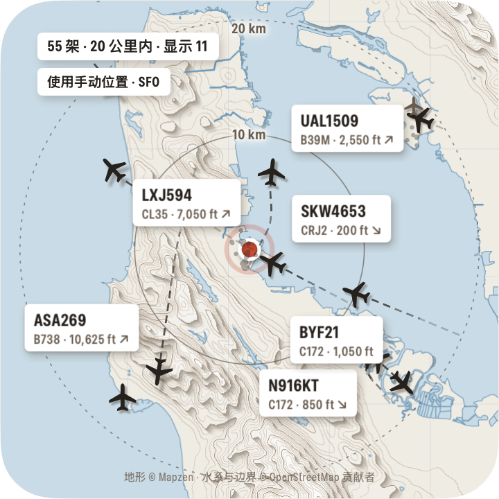
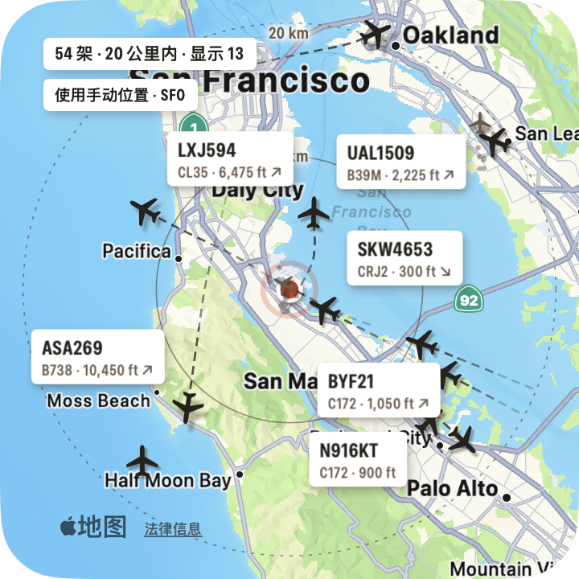
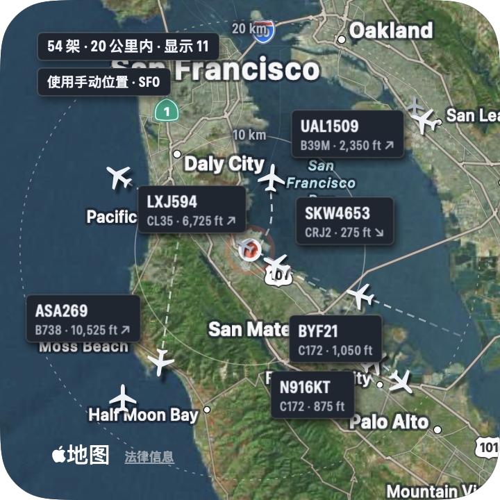

# HeadsUp · 附近天空

一款 macOS 原生桌面小组件：一块正方形的纸雕风格地图面板，实时显示你周围（默认 20 公里）天空中的飞机。

| 纸感 | 标准 | 卫星 |
| :-: | :-: | :-: |
|  |  |  |

## 运行

需要 macOS 14 或更新版本。

```bash
open build/HeadsUp.app
```

首次启动时系统会询问定位权限，请点"允许"。面板出现在屏幕右上角，菜单栏有一个飞机图标。可以把 `build/HeadsUp.app` 拖到"应用程序"文件夹里长期使用。

从源码构建（需要 Xcode 命令行工具）：

```bash
./scripts/build_app.sh
```

测试方法和测试结果见 [docs/testing.md](docs/testing.md)。

## 使用

- **移动面板**：拖动面板空白处。**调整大小**：鼠标悬停后拖动右下角，或在设置里拖"面板大小"。面板始终保持正方形。
- **航班详情**：点击飞机或它的标签。再点一次或点空白处关闭。
- **右键面板 / 菜单栏图标**：显示或隐藏面板、立即刷新、追踪半径、外观、窗口层级、设置、退出。
- **拖动和缩放地图**：在设置里打开"允许拖动和缩放地图"后，拖动空白处平移、触控板双指捏合缩放，飞机按当前看到的区域查询；原点（你的位置或手动位置）和距离圈不动，右上角的定位按钮回到原点和默认缩放。此时移动面板改为按住 ⌘ 拖动。macOS 只把触控板手势交给当前激活的应用，所以开关打开后，点一下面板会让 HeadsUp 获得焦点，之后即可双指缩放；点别的应用会把焦点还回去。开关关闭时面板从不抢焦点。
- **飞机多时的采样**：飞机超过面板能清楚显示的数量（约 60 架）时，整张图按屏幕网格采样，每格只完整画一架（优先点开的、空中的、离原点近的），其余画成淡色小点，计数里注明"显示 N"。上一次完整显示的飞机、带标签的飞机会尽量保持不变，避免飞机在图标和小点之间来回闪。
- **大范围缩放**：最远可缩放到 1200 公里。免费数据接口单次最多查约 460 公里半径，超过时把范围切成若干块轮流查询（交替使用 adsb.lol 和 adsb.fi，每个服务约每秒一次），首次查询新范围时飞机会逐块出现，状态栏显示进度；刷新间隔随块数变长（1000 公里约 13 块，约 15 秒刷新一次）。
- **位置搜索**：同时查 Apple 地图和 OpenStreetMap（Nominatim），Apple 数据里没有的地点（例如这台 Mac 上的不少中国大陆建筑）也能搜到。
- **窗口层级**：桌面（默认，在所有窗口下方，不打扰工作）、普通窗口、始终置顶。
- **设置**：追踪半径（5–150 km）、航班标签开关、航司/航班过滤、自动定位或手动位置（可搜索地名或输入"纬度, 经度"）、浅色/深色/跟随系统、地图样式（纸感/标准/卫星）、面板大小、登录时自动启动。所有设置和面板位置都会保存，重启后保留。

## 设计与实现

| 部分 | 选择 |
|---|---|
| 界面 | SwiftUI + AppKit（无边框 `NSPanel`，不抢键盘焦点；`LSUIElement`，不占 Dock） |
| 飞机位置 | [adsb.lol](https://adsb.lol) 点半径接口，失败或限流时自动切换到 [adsb.fi](https://adsb.fi)；每 5 秒刷新 |
| 航线与机型 | 默认用 [adsbdb.com](https://www.adsbdb.com)（免 Key，按航班号记录，常与当天航班不符，对不上时显示"航线未知"）；可在设置里接入 [FlightAware AeroAPI](https://www.flightaware.com/aeroapi/) 或 AirLabs（需自备 API Key，存于钥匙串），获取当天这一班的真实起降机场，失败时自动回退。点击飞机时才查询，缓存 20 分钟 |
| 纸雕底图 | [AWS Terrain Tiles](https://registry.opendata.aws/terrain-tiles/)（Mapzen terrarium 高程，免 Key），本地计算等高线、分层投影和海岸线；河流、运河、湖泊、水库、海岸以及国界和一级行政区界（中国的省、美国的州、其他国家对应的第一级行政区）来自 OpenStreetMap（[OpenFreeMap](https://openfreemap.org) 矢量瓦片，免 Key，应用内自带解码器）。两者都有磁盘缓存，离线时用缓存渲染 |
| 标准 / 卫星底图 | Apple MapKit |
| 定位 | CoreLocation；失败时可用手动位置或上次位置 |

要点：

- **平滑移动**：两次数据之间按航迹和地速推算位置；新数据到达时用 1.6 秒缓动消除跳变。轨迹虚线由真实历史位置连成。
- **低资源占用**：所有飞机、轨迹、标签在一个 Canvas 里绘制，标签和阴影预渲染缓存；帧率按飞机在屏幕上的移动速度自适应（最多 12 fps）。面板被完全遮挡、隐藏或屏幕休眠时停止轮询和动画。实测旧金山机场 20 公里内约 48 架飞机时 CPU 约 3%，面板隐藏时约 0.8%。
- **半径**：查询时按海里向上取整后再用精确的大圆距离筛选，地图范围跟随半径（外圈在面板 92% 处）。
- **缺失字段**：数据源没有的字段显示"—"；未广播呼号时显示注册号或 ICAO 地址；航线库记录与飞机当前位置、爬升/下降方向不符时，标注"航线库记录与当前位置不符，可能已过时"。
- **中国大陆坐标**：纸雕底图和 ADS-B 都是 WGS-84，不存在偏移。切到 Apple 地图时，如果位置在中国大陆，会用 MapKit 搜索一个已知地标判断当前 Mac 拿到的是不是 GCJ-02 底图，是的话把飞机坐标换算过去。
- **航司 / 航班过滤**：可填 ICAO 航司代码（UAL、CES）、IATA 航司代码（UA、MU，经 adsbdb 换算为 ICAO）或航班号（UAL1577、MU5101）。按飞机广播的呼号匹配。

## 已知限制

- **首次定位授权**要在系统弹窗中由用户点"允许"。这台 Mac 上没有开发者证书，应用只能临时签名，每次重新构建后系统会再次询问定位权限；拷贝到其他 Mac 首次打开可能需要右键 › 打开。
- **纸雕底图**：不画道路；平原城市起伏小，层次较少，高楼密集的市中心在高程数据里会显得略微隆起。河网特别密的地区（如长三角）会自动把线条画细。高程最高用到 z12（约 38 m/像素）。
- **行政边界**来自 OpenStreetMap，与各国官方版本可能存在差异；各国"第一级行政区"按 OpenStreetMap 的 admin_level=4 统一绘制，少数国家这一级的含义不同（例如有的国家是大区）。
- **数据覆盖**：社区 ADS-B 网络在部分地区（例如中国大陆部分城市）接收站很少，可能长时间显示没有飞机，这是数据源的真实情况，应用不会编造数据。
- **航线**：默认的免费航线库按呼号记录，航司复用呼号时常常不准，能识别出的矛盾会显示"航线未知"，但无法保证全部识别。配置 AirLabs 或 FlightAware 后使用当天航班的实际起降机场；AirLabs 免费额度有限，应用只在点开飞机时查询并缓存 20 分钟。
- **航线 Key 与钥匙串**：API Key 存在登录钥匙串里。应用是临时签名，重新构建后第一次读取 Key 时系统可能询问是否允许，点"始终允许"即可。
- 数据源均为社区服务，仅限个人非商业使用，请遵守各服务条款。

## 目录

```
Sources/HeadsUpCore   数据源、解析、追踪、过滤、航线、设置、地形渲染（可单元测试）
Sources/HeadsUp       应用外壳：面板、地图、飞机绘制、详情卡片、设置窗口、菜单
Tests/                单元测试
scripts/              构建脚本、测试实例启动、模拟数据源、测试控制命令
```
