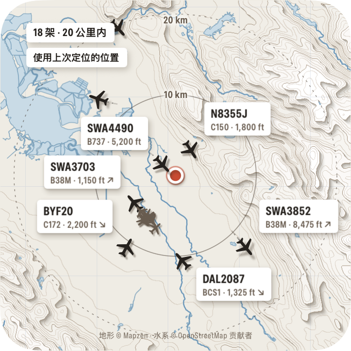
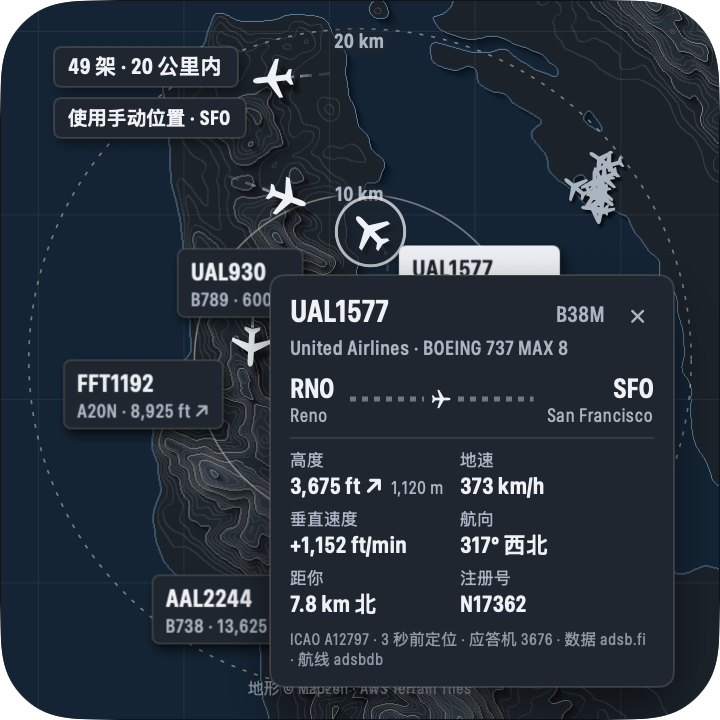

# HeadsUp · 附近天空

一款 macOS 原生桌面小组件：一块正方形的纸雕风格地图面板，实时显示你周围（默认 20 公里）天空中的飞机。

 

## 运行

需要 macOS 14 或更新版本。

```bash
open build/HeadsUp.app
```

首次启动时系统会询问定位权限，请点"允许"。面板出现在屏幕右上角，菜单栏有一个飞机图标。可以把 `build/HeadsUp.app` 拖到"应用程序"文件夹里长期使用。

从源码构建（需要 Xcode 命令行工具）：

```bash
./scripts/build_app.sh
```

运行单元测试：

```bash
swift test
```

## 使用

- **移动面板**：拖动面板空白处。**调整大小**：鼠标悬停后拖动右下角，或在设置里拖"面板大小"。面板始终保持正方形。
- **航班详情**：点击飞机或它的标签。再点一次或点空白处关闭。
- **右键面板 / 菜单栏图标**：显示或隐藏面板、立即刷新、追踪半径、外观、窗口层级、设置、退出。
- **拖动和缩放地图**：在设置里打开"允许拖动和缩放地图"后，拖动空白处平移、触控板双指捏合缩放，飞机按当前看到的区域查询；原点（你的位置或手动位置）和距离圈不动，右上角的定位按钮回到原点和默认缩放。此时移动面板改为按住 ⌘ 拖动。
- **飞机多时的采样**：飞机超过面板能清楚显示的数量（约 60 架）时，整张图按屏幕网格采样，每格只完整画一架（优先点开的、空中的、离原点近的），其余画成淡色小点，计数里注明"显示 N"。
- **大范围缩放**：最远可缩放到 1200 公里。免费数据接口单次最多查约 460 公里半径，超过时把范围切成若干块轮流查询（交替使用 adsb.lol 和 adsb.fi，每个服务约每秒一次），首次查询新范围时飞机会逐块出现，状态栏显示进度；刷新间隔随块数变长（1000 公里约 13 块，约 15 秒刷新一次）。
- **位置搜索**：同时查 Apple 地图和 OpenStreetMap（Nominatim），Apple 数据里没有的地点（例如这台 Mac 上的不少中国大陆建筑）也能搜到。
- **窗口层级**：桌面（默认，在所有窗口下方，不打扰工作）、普通窗口、始终置顶。
- **设置**：追踪半径（5–150 km）、航班标签开关、航司/航班过滤、自动定位或手动位置（可搜索地名或输入"纬度, 经度"）、浅色/深色/跟随系统、地图样式（纸感/标准/卫星）、面板大小、登录时自动启动。所有设置和面板位置都会保存，重启后保留。

## 设计与实现

| 部分 | 选择 |
|---|---|
| 界面 | SwiftUI + AppKit（无边框 `NSPanel`，不抢键盘焦点；`LSUIElement`，不占 Dock） |
| 飞机位置 | [adsb.lol](https://adsb.lol) 点半径接口，失败或限流时自动切换到 [adsb.fi](https://adsb.fi)；每 5 秒刷新 |
| 航线与机型 | 默认用 [adsbdb.com](https://www.adsbdb.com)（免 Key，按航班号记录，常与当天航班不符，对不上时显示"航线未知"）；可在设置里接入 [FlightAware AeroAPI](https://www.flightaware.com/aeroapi/) 或 AirLabs（需自备 API Key，存于钥匙串），获取当天这一班的真实起降机场，失败时自动回退。点击飞机时才查询，缓存 20 分钟 |
| 纸雕底图 | [AWS Terrain Tiles](https://registry.opendata.aws/terrain-tiles/)（Mapzen terrarium 高程，免 Key），本地计算等高线、分层投影和海岸线；河流、运河、湖泊、水库、海岸以及国界和一级行政区界（中国的省、美国的州、其他国家对应的第一级行政区）来自 OpenStreetMap（[OpenFreeMap](https://openfreemap.org) 矢量瓦片，免 Key，应用内自带解码器）。两者都有磁盘缓存，离线时用缓存渲染 |
| 标准 / 卫星底图 | Apple MapKit |
| 定位 | CoreLocation；失败时可用手动位置或上次位置 |

要点：

- **平滑移动**：两次数据之间按航迹和地速推算位置；新数据到达时用 1.6 秒缓动消除跳变。轨迹虚线由真实历史位置连成。
- **低资源占用**：所有飞机、轨迹、标签在一个 Canvas 里绘制，标签和阴影预渲染缓存；帧率按飞机在屏幕上的移动速度自适应（最多 12 fps）。面板被完全遮挡、隐藏或屏幕休眠时停止轮询和动画。实测旧金山机场 20 公里内约 48 架飞机时 CPU 约 3%，面板隐藏时约 0.8%。
- **半径**：查询时按海里向上取整后再用精确的大圆距离筛选，地图范围跟随半径（外圈在面板 92% 处）。
- **缺失字段**：数据源没有的字段显示"—"；未广播呼号时显示注册号或 ICAO 地址；航线库记录与飞机当前位置、爬升/下降方向不符时，标注"航线库记录与当前位置不符，可能已过时"。
- **中国大陆坐标**：纸雕底图和 ADS-B 都是 WGS-84，不存在偏移。切到 Apple 地图时，如果位置在中国大陆，会用 MapKit 搜索一个已知地标判断当前 Mac 拿到的是不是 GCJ-02 底图，是的话把飞机坐标换算过去。
- **航司 / 航班过滤**：可填 ICAO 航司代码（UAL、CES）、IATA 航司代码（UA、MU，经 adsbdb 换算为 ICAO）或航班号（UAL1577、MU5101）。按飞机广播的呼号匹配。

## 测试结果

单元测试（`swift test`）：36 项全部通过，覆盖坐标计算与 GCJ-02 换算、两种数据源 JSON 解析（含 `"ground"` 高度、TIS-B 地址、垃圾响应）、航位推算、半径精确筛选与半径变更、数据源切换与限流冷却、离线/HTTP 错误状态与过期数据清除、空域计数、航司过滤解析与匹配、航线合理性判断、设置默认值（20 km）与持久化、地形瓦片覆盖、等高线间距、水面渲染、高程 PNG 解码、矢量瓦片几何与图层解码（跳过泳池、隧道，只保留国界和一级行政区界、跳过海上界线）、河流绘制、AeroAPI / AirLabs 响应解析与航班选择、Key 无效时回退、OpenStreetMap 地点解析与去重合并、大范围分块查询的覆盖与合并。

实机运行（构建产物 `build/HeadsUp.app`，通过内置测试钩子截图和导出状态）：

| 场景 | 结果 |
|---|---|
| 真实数据链路 | 通过：旧金山机场 20 km 内 41–50 架，西雅图 33 架，实时位置（圣何塞附近）13 架 |
| 默认半径 | 通过：全新设置启动为 20 km |
| 改半径 | 通过：10 / 50 / 20 km 时显示 28 / 76 / 47 架，最远距离 5.3 / 49.5 / 19.8 km，地图与距离圈同步缩放 |
| 重启后保留 | 通过：半径 35 km、面板位置与大小、深色、窗口层级、过滤条件全部恢复 |
| 航班详情 | 通过：航班号、航司、机型全称、起降机场、高度（ft/m）、地速、垂直速度、航向、距离方位、注册号；免费航线库的记录与位置矛盾时显示"航线未知" |
| 航司过滤 | 通过：`UA, MU5101, ZZ` → 匹配 UAL*、CES5101、OTT5101，ZZ 提示找不到 |
| 浅色 / 深色 | 通过：两套配色，地形与卡片随之切换 |
| 无网络 | 通过：用 `sandbox-exec` 禁止应用联网后启动，提示"无法连接数据服务"并持续重试，不再在"错误"和"正在获取"之间跳动（发现并修复的问题）；地形和水系用缓存照常显示 |
| 纸雕行政边界 | 通过：太浩湖一带画出加州 / 内华达州州界，上海青浦一带画出上海 / 江苏 / 浙江省界，比荷边境画出国界（较粗的点划线）和两国的省界（较细的虚线），西安以西画出陕西 / 甘肃省界；深色模式同样清晰。OpenStreetMap 标为争议的界线画得更淡 |
| 纸雕河流 | 通过：圣何塞的 Guadalupe River、Coyote Creek 和南湾盐田，旧金山的水库和溪流，上海的黄浦江与河网，北京的护城河都能画出 |
| 鼠标操作（真实系统鼠标事件） | 通过：拖动空白处移动面板（位移 -100,-100 pt）、悬停后拖右下角缩放（360→420 pt，保持正方形、左上角不动）、点飞机打开详情（显示 SFO→KCMA）、点空白处关闭、右键弹出菜单并可关闭 |
| 拖动地图（真实系统鼠标事件） | 通过：打开"允许拖动和缩放地图"后拖动空白处，地图向东北平移，原点圆点和距离圈随原点移动、飞机按新视图重新查询（15→5 架），地形重绘；点回到原点按钮后恢复（14 架）。按住 ⌘ 拖动面板由你手动测试通过 |
| 整体采样 | 通过：旧金山一带缩放到 400 公里共 192 架、完整显示 35 架，1000 公里共 565 架、完整显示 37 架，中心不再挤成一团，其余为淡点 |
| 缩放到 1000 / 1200 公里 | 通过：1000 公里分 13 块查询，飞机在 5 秒、10 秒、15 秒时依次出现 187 → 361 → 556 架；1200 公里共 871 架进入查询结果。某块被限流时自动换另一个服务重试，仍失败时提示"部分区域数据获取失败" |
| 缩放流畅度 | 通过：以每秒 60 次连续改变缩放模拟捏合，主线程约 84% 时间空闲，120 次缩放用时 2.2 秒（理想 2.0 秒）；捏合过程中不再反复重算地形，结束后重算一次。大范围静止时 CPU 约 1% |
| 双指缩放 | 通过（合成事件，未用手指实测）：合成的触控板捏合事件经系统事件队列送达面板，视图从 20 km 放大到 37 km（飞机 13→26 架）再缩小到 12 km（8 架），距离圈保持 20 km；真实点击回到原点按钮后恢复 20 km |
| 位置搜索 | 通过："西安新长安广场"（原先报 MKErrorDomain 错误 4）现在由 OpenStreetMap 返回；"上海外滩"由 Apple 返回；乱码查询提示没找到；断网时提示连不上服务 |
| AirLabs 真实数据 | 通过：西安附近 10 架空中航班，8 架与免费航线库一致，2 架不同（CES2163 免费库为 TYN→KMG、AirLabs 为 PVG→XIY；CSN6917 免费库为 CGO→FOC 且与位置矛盾，AirLabs 为 URC→CGO），AirLabs 的结果都与飞机位置和航向相符 |
| 航线服务接入 | 用模拟的 AeroAPI 测通了整条链路：错误 Key 自动回退到免费航线库，正确 Key 时详情显示服务返回的航线、页脚标注"航线 FlightAware"，地面飞机按"刚落地 / 即将起飞"选择航班。AirLabs 已用真实 Key 验证（见上一行）；FlightAware 没有真实 Key，未验证 |
| 航线显示 | 登记航线与飞机位置矛盾时显示"航线未知"，不再显示错误的起降机场（实时核对 45 架中 22 架属于这种情况） |
| API 返回 500 / 429 / 非 JSON / 连接被拒 | 通过：分别提示"HTTP 500""限流""数据格式异常""无法连接数据服务"，并自动重试 |
| 附近没有飞机 | 通过：太平洋中部和模拟空响应都显示"20 公里内暂时没有飞机"，连续为空时说明可能是接收站覆盖有限 |
| 定位被拒 / 定位失败 | 通过：显示原因和"设置位置…"按钮；设置手动位置后恢复正常 |
| CPU | 约 3%（48 架），无飞机约 0.3%，隐藏时约 0.8% |

## 已知限制

- **真实断网**（关掉 Wi-Fi）没有实测，因为会中断开发会话；改用沙箱禁止应用联网来实测。系统级断网时 macOS 会立即报告离线，应用显示"网络不可用"，这条路径由单元测试覆盖。
- **桌面层的鼠标操作**没有实测：测试时面板所在位置被其他应用的全屏窗口挡住，合成点击会落到别的应用上。鼠标操作是在"始终置顶"层级下测的。
- **首次定位授权**要在系统弹窗中由用户点"允许"。这台 Mac 上没有开发者证书，应用只能临时签名，每次重新构建后系统会再次询问定位权限；拷贝到其他 Mac 首次打开可能需要右键 › 打开。
- **纸雕底图**：不画道路；平原城市起伏小，层次较少，高楼密集的市中心在高程数据里会显得略微隆起。河网特别密的地区（如长三角）会自动把线条画细。高程最高用到 z12（约 38 m/像素）。
- **行政边界**来自 OpenStreetMap，与各国官方版本可能存在差异；各国"第一级行政区"按 OpenStreetMap 的 admin_level=4 统一绘制，少数国家这一级的含义不同（例如有的国家是大区）。
- **GCJ-02**：这台 Mac 上的 Apple 地图在北京实测为 WGS-84（无偏移），换算逻辑实现了但没有在真正的 GCJ-02 底图上验证。默认的纸雕底图不受影响。
- **数据覆盖**：社区 ADS-B 网络在部分地区（例如中国大陆部分城市）接收站很少，可能长时间显示没有飞机，这是数据源的真实情况，应用不会编造数据。
- **航线**：默认的免费航线库按呼号记录，航司复用呼号时常常不准，能识别出的矛盾会显示"航线未知"，但无法保证全部识别。配置 AirLabs 或 FlightAware 后使用当天航班的实际起降机场；AirLabs 免费额度有限，应用只在点开飞机时查询并缓存 20 分钟。
- **"登录时自动启动"**会修改系统登录项，未在本机实测。
- **双指缩放**是用合成的触控板事件测的，没有用手指在触控板上实测。
- **航线 Key 与钥匙串**：API Key 存在登录钥匙串里。应用是临时签名，重新构建后第一次读取 Key 时系统可能询问是否允许，点"始终允许"即可。
- 数据源均为社区服务，仅限个人非商业使用，请遵守各服务条款。

## 目录

```
Sources/HeadsUpCore   数据源、解析、追踪、过滤、航线、设置、地形渲染（可单元测试）
Sources/HeadsUp       应用外壳：面板、地图、飞机绘制、详情卡片、设置窗口、菜单
Tests/                单元测试
scripts/              构建脚本、测试实例启动、模拟数据源、测试控制命令
```

`scripts/run_test_instance.sh` 和 `build/hctl` 用于自动化测试：以 `HEADSUP_TEST_CONTROL=1` 启动时，应用接受截图、导出状态、改半径等命令；正常启动时这个钩子不开启。
